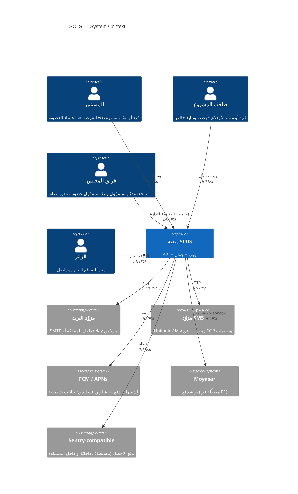
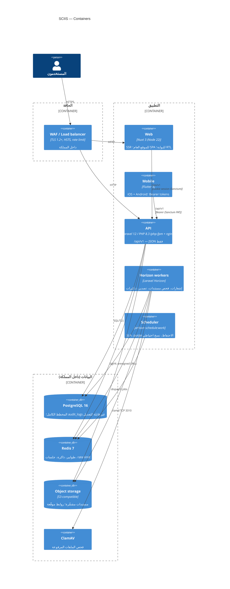
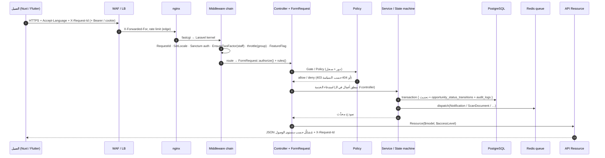
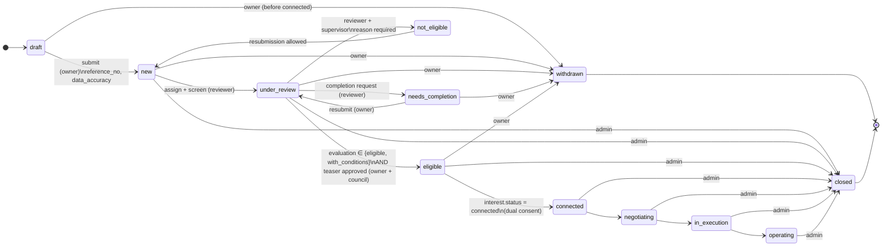
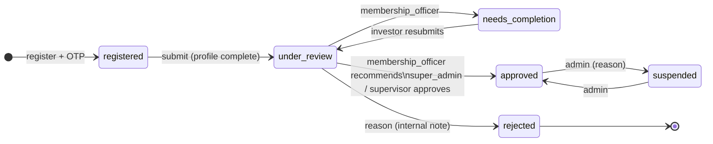
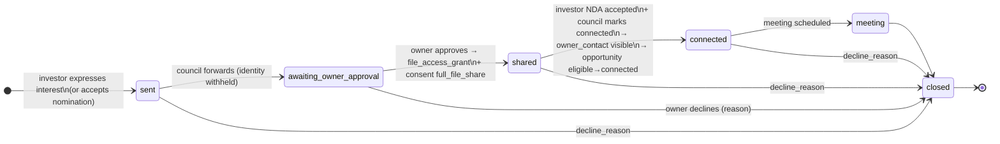
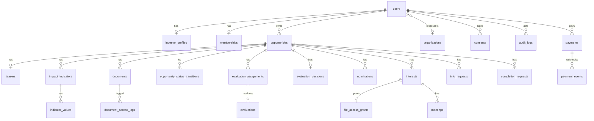

<div dir="rtl">

# معمارية منصة SCIIS

> الوثيقة المعمارية المرجعية. تُقرأ مع [`SPEC.md`](SPEC.md) (المصدر الملزم) و[`openapi.yaml`](openapi.yaml) (العقد).
> المصطلحات التقنية تُترك بالإنجليزية عمدًا لتطابق الكود.

---

## 1. السياق (C4 — المستوى الأول)



**حدود النظام:** المنصة لا تحتفظ بأموال، ولا تُصدر أوراقًا مالية، ولا تنفّذ صفقات (الوثيقة §4.1، §16.1). دورها: التأهيل، الربط، التوثيق، والمتابعة.

---

## 2. الحاويات (C4 — المستوى الثاني)



| الحاوية | الحالة | النسخ | ملاحظة |
|---|---|---|---|
| web | stateless | N | SSR للصفحات العامة فقط؛ لا كوكي جلسة على SSR |
| api | stateless | N | الجلسات في Redis؛ الملفات في S3 — قابل للتوسّع أفقيًا (SCL-01/02) |
| horizon | stateless | N | كل worker يسحب من Redis؛ `--balance=auto` |
| scheduler | **نسخة واحدة** | 1 | يستخدم `onOneServer()` لكل أمر لتجنّب التكرار عند التوسّع |
| postgres | stateful | 1 + replica | primary + streaming replica في منطقة ثانية داخل المملكة |

---

## 3. المكوّنات (C4 — المستوى الثالث) — خريطة وحدات الـ API

```
api/app/
├── Enums/                      SPEC §2 — string-backed، مرآة في web/types و mobile/lib/core
├── Models/                     Eloquent؛ uuid على الكيانات الخارجية؛ SoftDeletes حيث تنص المواصفة
├── Policies/                   RBAC + صلاحيات على مستوى السجل (ACC-04, EVL-04)
├── Http/
│   ├── Controllers/Api/V1/
│   │   ├── Auth/               register, verify, login, 2fa, logout, password
│   │   ├── Me/                 me, device-tokens, preferences, data-requests
│   │   ├── Investor/           profile, membership, dashboard, saved, interests, nominations, info-requests
│   │   ├── Opportunities/      list, show, save, interest, info-requests, nda, documents
│   │   ├── Entrepreneur/       dashboard, opportunities CRUD, submit, withdraw, indicators, documents, preview, access-requests
│   │   ├── Admin/              dashboard, opportunities, evaluation, teaser, candidates, nominations, interests, meetings, memberships, users, settings, taxonomies, criteria, reports, audit, content
│   │   ├── Public/             pages, faqs, news, events, stats, contact, featured
│   │   ├── Payments/           intents, show, cancel, webhook
│   │   └── System/             health, version
│   ├── Requests/               FormRequest لكل عملية كتابة (التحقق + التفويض)
│   ├── Resources/              OpportunityCardResource · OpportunityDetailResource($accessLevel) · OpportunityFullResource · …
│   └── Middleware/             EnsureTwoFactor (staff), SetLocale, RequestId, SecurityHeaders (CSP), FeatureFlag, Audit
├── Services/
│   ├── Opportunities/OpportunityStateMachine.php      الانتقال الوحيد المسموح (ADM-01)
│   ├── Memberships/MembershipStateMachine.php
│   ├── Interests/InterestStateMachine.php             الموافقة المزدوجة (ENT-06)
│   ├── Access/AccessLevelResolver.php                  يحسب AccessLevel للمستدعي على فرصة
│   ├── Matching/CandidateRanker.php                    match_score = عدد المعايير المطابقة (MAT-02) + استبعاد COI (MAT-04)
│   ├── Evaluation/ScoringService.php                   axis_totals, overall؛ نسخة المعايير المجمّدة (EVL-01)
│   ├── Documents/{DocumentUploader, SignedUrlIssuer, ScanDocumentJob}
│   ├── Notifications/NotificationRouter.php            يقرأ notification_preferences ويوزّع على القنوات
│   ├── Reports/ReportRegistry.php                      مفاتيح §8، محسوبة من DB
│   ├── Payments/{PaymentGateway (interface), MoyasarGateway, Ledger}
│   ├── Privacy/{DataRequestHandler, RetentionPurger}  PRV-03/04
│   └── Audit/AuditLogger.php                           إدخال فقط؛ لا update/delete
├── Events/ + Listeners/        OpportunityStatusChanged, InterestStatusChanged, PaymentPaid, DocumentScanned …
├── Jobs/                       ScanDocumentJob, SendOtpJob, ExportReportJob, SendSlaRemindersJob, PurgeRetentionJob
├── Console/Commands/           sla:remind, privacy:purge, backup:run, reports:warm
└── Support/                    ReferenceNumber (A-YYYY-NNNN), Settings (cached), Taxonomy
```

---

## 4. تدفق الطلب (Request flow)



قواعد ثابتة:
- **لا يكتب الـ controller في قاعدة البيانات مباشرة** لعمليات الحالة؛ كل انتقال عبر State machine.
- **التدقيق داخل نفس المعاملة** (transaction) مع التغيير؛ فشل التدقيق يُلغي التغيير.
- **الـ Resource هو الحارس الأخير** للحساسية: الحقول السرية لا تُضاف إلا بشرط `$accessLevel`.

---

## 5. الكشف التدريجي (Progressive disclosure)

### 5.1 حساب مستوى الوصول

```
AccessLevelResolver::for(User $u, Opportunity $o): AccessLevel
  visitor           ← غير مسجَّل
  registered        ← مسجَّل (بريد + جوال موثَّقان) وعضوية غير معتمدة
  approved_member   ← memberships.status = approved AND terms_accepted_at IS NOT NULL
  granted           ← approved_member AND file_access_grants(opportunity, investor).revoked_at IS NULL
                      AND consents(nda, subject=opportunity) موجود
  connected         ← granted AND interests(opportunity, investor).status = connected
```

### 5.2 مصفوفة التشكيل (من SPEC §5)

| مجموعة الحقول | card | detail (approved_member) | detail (granted) | detail (connected) | الحساسية |
|---|---|---|---|---|---|
| الاسم، المنشأة، القطاع، المرحلة، المناطق، أنواع الاستثمار، سنة التأسيس | ✓ | ✓ | ✓ | ✓ | ع |
| الملخص (سطران)، المستفيدون المستهدفون والفئات | ✓ | ✓ | ✓ | ✓ | ع |
| المشكلة، الحل، التغيير المتوقع، المؤشر الرئيسي | — | ✓ | ✓ | ✓ | ع |
| المؤشرات المفصح عنها | — | ✓ | ✓ | ✓ | ع |
| مبلغ التمويل | نطاق/دقيق حسب الإعداد | نطاق/دقيق حسب الإعداد | دقيق | دقيق | س → ع بقرار |
| أوجه الاستخدام | — | ملخص % | تفصيلي | تفصيلي | س |
| المخاطر والإفصاحات | — | ملخص | كامل | كامل | س |
| القوائم المالية، العرض الكامل، المستندات | — | 🔒 locked | رابط موقّع + سجل وصول | نفسه | س |
| بيانات تواصل صاحب المشروع | — | — | — | ✓ | ح |
| الملاحظات الداخلية، علاقة المجلس | — | — | — | — | د (staff فقط) |

### 5.3 التنفيذ

```php
// OpportunityDetailResource
public function __construct(Opportunity $o, private AccessLevel $level) { parent::__construct($o); }

public function toArray($request): array {
    $granted   = $this->level->atLeast(AccessLevel::Granted);
    $connected = $this->level === AccessLevel::Connected;
    return [
        ...(new OpportunityCardResource($this->resource))->toArray($request),
        'access_level'      => $this->level->value,
        'problem_statement' => $this->problem_statement,
        // …
        'funding_amount'    => $this->when($granted, fn () => $this->funding_amount),
        'use_of_funds'      => $granted ? $this->use_of_funds : ['summary' => $this->useOfFundsSummary()],
        'risks'             => ['summary' => $this->risksSummary(), 'full' => $this->when($granted, $this->operational_risks)],
        'documents'         => $granted ? ['locked' => false, 'items' => DocumentResource::collection($this->documents)]
                                        : ['locked' => true],
        'owner_contact'     => $this->when($connected, fn () => [...]),
    ];
}
```

اختبار Pest إلزامي (`tests/Feature/Sensitivity/NoLeakTest.php`) يمرّ على كل مستوى ويؤكّد **غياب** مفاتيح `confidential`/`sensitive_personal` بالاسم. انظر [`TESTING.md`](TESTING.md).

---

## 6. آلات الحالات

### 6.1 الفرصة (ADM-01)



جدول الانتقالات المسموحة (المصدر في `OpportunityStateMachine::ALLOWED`):

| من \ إلى | new | under_review | needs_completion | not_eligible | eligible | connected | negotiating | in_execution | operating | withdrawn | closed |
|---|---|---|---|---|---|---|---|---|---|---|---|
| draft | owner | | | | | | | | | owner | |
| new | | reviewer | | | | | | | | owner | admin |
| under_review | ✗ | | reviewer | reviewer+supervisor | matching/supervisor | | | | | owner | admin |
| needs_completion | | owner | | | | | | | | owner | admin |
| not_eligible | owner (resubmit) | | | | | | | | | | admin |
| eligible | | | | | | system (interest connected) | | | | owner | admin |
| connected | | | | | | | matching | | | | admin |
| negotiating | | | | | | | | impact | | | admin |
| in_execution | | | | | | | | | impact | | admin |
| operating | | | | | | | | | | | admin |

ملاحظات: `under_review → new` **غير مسموح** (الوثيقة §4.3). كل انتقال يكتب `opportunity_status_transitions` + `audit_logs` ويطلق `OpportunityStatusChanged`. أيام SLA من `settings.sla.*`.

### 6.2 العضوية



شرط `approved` الفعلي للوصول: `terms_accepted_at` مضبوط (قبول الشروط بعد الاعتماد).

### 6.3 الاهتمام (الموافقة المزدوجة)



قيد فريد: `(opportunity_id, investor_user_id)` بينما الحالة ≠ `closed` (فهرس جزئي).

---

## 7. نموذج البيانات — نظرة علوية



المخطط الكامل بالأعمدة في [`SPEC.md`](SPEC.md) §4.

---

## 8. إقامة البيانات (Data residency) — PRV-05

| الصنف | أين | التحكم |
|---|---|---|
| قاعدة البيانات، Redis، التخزين، السجلات | داخل المملكة حصرًا | إعداد `AWS_ENDPOINT` وسياسة الشبكة؛ لا مفاتيح لمناطق خارجية |
| البريد | مزوّد داخل المملكة أو relay مرخَّص؛ لا بيانات حساسة في المتن | قوالب تحتوي روابط فقط |
| SMS | مزوّد سعودي مرخَّص من CST | OTP فقط |
| الدفع (FCM/APNs) | خارج المملكة بطبيعته | **لا بيانات شخصية**: عنوان + مسار داخلي فقط |
| Moyasar | سعودية | لا تُخزَّن بيانات بطاقات لدينا أبدًا (tokenization لديهم) |
| تتبّع الأخطاء | Sentry self-hosted داخل المملكة أو تعطيل PII scrubbing… | `send_default_pii=false` |
| تحليلات الويب | لا طرف ثالث بدون موافقة | Plausible self-hosted اختياريًا |

---

## 9. التوسّع والأداء

- **API/Web/Horizon** بلا حالة → زيادة النسخ خلف الموازن. القاعدة: 2 نسخ API + 2 Horizon كحد أدنى إنتاجيًا.
- **قاعدة البيانات**: فهارس جزئية على `(status) WHERE status IN (...)`، `pg_trgm` للبحث، `JSONB GIN` على `scores` و`use_of_funds`. القراءة الثقيلة (التقارير) على replica عبر `DB::connection('pgsql_read')`.
- **الذاكرة**: الإعدادات والتصنيفات والمعايير مخبّأة في Redis مع إبطال عند التعديل؛ `/public/stats` مخبّأ ساعة.
- **الملفات**: الرفع إلى S3 مباشرة عبر presigned POST في P2؛ في P1 عبر الـ API (حد 25MB).
- **الأهداف**: p95 < 400ms لنقاط القراءة، < 1s للوحات؛ 500 مستخدم متزامن في P1 دون تغيير معماري.

---

## 10. سجلات قرارات المعمارية (ADR)

### ADR-001 — Laravel بدلًا من NestJS

| | |
|---|---|
| **السياق** | الوثيقة تتطلب RBAC دقيقًا، آلات حالات، طوابير، إشعارات متعددة القنوات، جدولة، تدقيق — وفريق يعمل أصلًا بـ Laravel + Vue |
| **البدائل** | NestJS (TypeScript) + TypeORM/Prisma + BullMQ؛ Django REST |
| **القرار** | Laravel 12 API-only |
| **الأسباب** | Sanctum يغطي الويب والجوال معًا؛ Policies/Gates + spatie/permission جاهزة؛ Horizon لمراقبة الطوابير؛ Notifications بقنوات database/mail/sms؛ Scheduler مدمج؛ Pest/Pint؛ خبرة الفريق تقلّل مخاطر الصيانة. NestJS كان سيتطلب تجميع 6–8 مكتبات لتحقيق المكافئ |
| **العواقب** | لغة واحدة للـ API (PHP) ولغة ثانية للواجهات (TS/Dart)؛ يُعوَّض بعقد OpenAPI صارم ومرايا التعدادات |

### ADR-002 — PostgreSQL بدلًا من MySQL/MariaDB

| | |
|---|---|
| **السياق** | إجابات نماذج مرنة (FRM-01 في P2)، درجات تقييم JSON، قيود صفية، تدقيق غير قابل للتعديل |
| **القرار** | PostgreSQL 16 |
| **الأسباب** | JSONB + فهارس GIN؛ فهارس جزئية (`UNIQUE … WHERE status <> 'closed'`)؛ `CHECK` constraints وأنواع صارمة؛ محفّزات لمنع UPDATE/DELETE على `audit_logs`؛ `pg_trgm` للبحث العربي؛ أدوات نسخ احتياطي ناضجة (`pg_dump -Fc`, PITR) |
| **العواقب** | الفريق يحتاج إلمامًا بـ Postgres؛ Laravel يدعمه بالكامل |

### ADR-003 — Nuxt 3 بدلًا من Vue SPA خالص أو Next.js

| | |
|---|---|
| **السياق** | موقع عام يحتاج SEO وسرعة، وبوابة خاصة لا تحتاج SSR؛ الفريق يعرف Vue |
| **القرار** | Nuxt 3 مع `routeRules`: prerender/SSR للعام، `ssr: false` للبوابة |
| **الأسباب** | Vue نفسه؛ i18n وRTL مدمجان عبر `@nuxtjs/i18n`؛ Nitro يعمل في حاوية خفيفة؛ لا حاجة لـ React |
| **العواقب** | Node في الإنتاج لخدمة SSR (حاوية إضافية)؛ مقبول |

### ADR-004 — Flutter بدلًا من React Native

| | |
|---|---|
| **السياق** | تطبيق عربي RTL أولًا، كود واحد، أداء أصيل، ميزانية فريق صغيرة |
| **القرار** | Flutter 3 (Dart) |
| **الأسباب** | RTL وتشكيل العربية في محرّك الرسم نفسه (لا اعتماد على مكوّنات المنصة)؛ أداء ثابت على Android منخفض الفئة؛ أدوات l10n مدمجة (`gen-l10n` + ARB)؛ `flutter_secure_storage` للرمز؛ منحنى التعلّم مقبول مع خلفية Vue/TS. React Native كان سيضيف طبقة JS bridge ومكتبات RTL غير متسقة |
| **العواقب** | لغة ثالثة (Dart)؛ يُعوَّض بتصميم الـ API للجوال أولًا وبقاء كل المنطق في الخادم |

### ADR-005 — تجريد بوابة الدفع مع مشغّل Moyasar

| | |
|---|---|
| **السياق** | المدفوعات محدودة (عضوية/خدمات/تدريب/رعاية)، معطّلة في P1، وقد تتغير البوابة (PayTabs, HyperPay, Tap) |
| **القرار** | واجهة `PaymentGateway { createIntent, fetch, refund, verifyWebhook }` + `MoyasarGateway` + سجل `Ledger` داخلي |
| **الأسباب** | Moyasar تدعم Mada وApple Pay وSTC Pay من يوم واحد؛ تبديل المزوّد = مشغّل جديد فقط؛ الـ webhook idempotent على `gateway_payment_id`؛ لا بيانات بطاقات لدينا |
| **العواقب** | يلزم اختبار عقد المشغّل (contract test) عند الإضافة؛ انظر [`PAYMENTS.md`](PAYMENTS.md) |

### ADR-006 — سجل تدقيق غير قابل للتعديل

| | |
|---|---|
| **السياق** | AUD-02 يتطلب أن لا يُحدَّث أو يُحذف أي سطر تدقيق؛ NCA ECC 2-12 |
| **القرار** | جدول `audit_logs` إدخال فقط: (1) محفّز PostgreSQL `audit_logs_immutable` يرفض `UPDATE`/`DELETE` بـ `RAISE EXCEPTION`؛ (2) النموذج لا يملك `update/delete`؛ (3) دور الـ API في قاعدة البيانات بلا صلاحية `UPDATE/DELETE` على الجدول؛ (4) نسخ ليلي للسجل إلى حاوية WORM (object lock) |
| **البدائل المرفوضة** | جدول عادي مع «لا تحدّث من فضلك»؛ خدمة تدقيق خارجية (تعقيد زائد لـ P1) |
| **العواقب** | تصحيح الأخطاء في السجل يكون بإدخال سطر تعويضي (`action=audit.correction`) لا بتعديل؛ حجم الجدول ينمو — تقسيم شهري (partitioning) في P2 |

</div>
