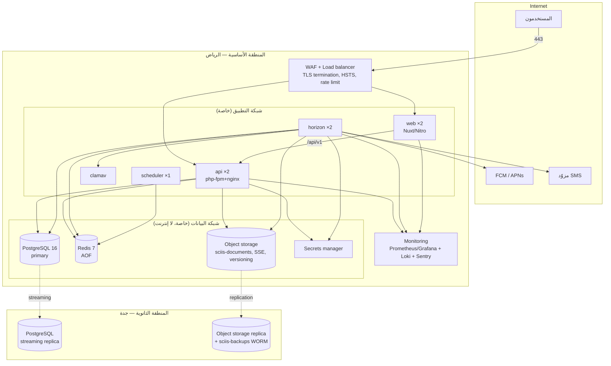
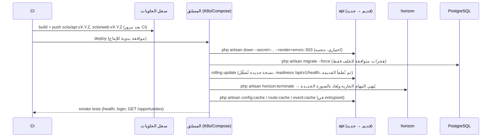

<div dir="rtl">

# نشر منصة SCIIS وتشغيلها

> يغطي BKP-01..03، SCL-01..02، SEC-04، PRV-05. يُقرأ مع [`SECURITY.md`](SECURITY.md) و[`ARCHITECTURE.md`](ARCHITECTURE.md).

---

## 1. خيارات الاستضافة داخل المملكة

الشرط غير القابل للتفاوض: **كل البيانات والنسخ الاحتياطية والسجلات داخل المملكة** (PRV-05)، لدى مزوّد مصنَّف من هيئة الاتصالات والفضاء والتقنية (CST) ومتوافق مع ضوابط NCA للحوسبة السحابية (CCC).

| المعيار | STC Cloud | Oracle Cloud (جدة/الرياض) | AWS (me-central-1 الإمارات) / AWS KSA | Azure (Saudi Arabia East) | On-prem / مركز بيانات محلي |
|---|---|---|---|---|---|
| الإقامة داخل المملكة | ✓ | ✓ | **AWS me-central-1 خارج المملكة ✗**؛ منطقة AWS KSA عند توفرها ✓ | ✓ (عند التوفر التجاري الكامل) | ✓ |
| تصنيف CST / توافق CCC | ✓ | ✓ | يُتحقَّق | يُتحقَّق | مسؤولية المجلس |
| Managed PostgreSQL | محدود | ✓ (OCI Database for PostgreSQL) | ✓ RDS | ✓ Flexible Server | ✗ (ندير بأنفسنا) |
| Managed Redis | محدود | ✓ | ✓ ElastiCache | ✓ | ✗ |
| تخزين كائنات S3-compatible | ✓ | ✓ (OCI Object Storage، S3 API) | ✓ | ✓ (Blob + S3 proxy) | MinIO |
| Kubernetes مُدار | ✓ | ✓ OKE | ✓ EKS | ✓ AKS | k3s / Docker Swarm |
| منطقة ثانية داخل المملكة للنسخ | ✓ (الرياض/جدة) | ✓ (جدة + الرياض) | ✗ حاليًا | ✗ حاليًا | يتطلب موقعًا ثانيًا |
| التكلفة التقديرية لـ P1 (شهريًا) | متوسطة | متوسطة | متوسطة–مرتفعة | متوسطة–مرتفعة | منخفضة تشغيليًا، مرتفعة بشريًا |
| نضج الأدوات والدعم | محلي، عربي | عالمي + حضور محلي | عالمي | عالمي | — |
| **التوصية** | **مناسب لـ P1** إن توفّر Postgres مُدار أو قبلنا إدارته | **الخيار الأول**: منطقتان داخل المملكة + خدمات مُدارة | فقط عند توفر منطقة داخل المملكة رسميًا | مناسب بعد التأكد من الإقامة والخدمات | للمجلس إن توفر فريق تشغيل؛ غير موصى به لـ P1 |

**القرار المقترح لـ P1:** Oracle Cloud (الرياض كأساسي، جدة للنسخ) أو STC Cloud، مع Docker Compose على VM لبيئة الاختبار وK8s مُدار (أو Compose على VMs بموازن) للإنتاج. يُثبَّت بعد عرض الأسعار والتحقق من شهادات الامتثال.

---

## 2. الطوبولوجيا المرجعية (إنتاج)



| المكوّن | المواصفة الدنيا (P1) | ملاحظات |
|---|---|---|
| api | 2 × (2 vCPU, 4 GB) | php-fpm `pm.max_children=40` لكل نسخة |
| web | 2 × (1 vCPU, 2 GB) | Nitro |
| horizon | 2 × (2 vCPU, 4 GB) | `--balance=auto --max-processes=10` |
| scheduler | 1 × (1 vCPU, 1 GB) | `onOneServer()` |
| postgres | 4 vCPU, 16 GB, SSD 200 GB | `shared_buffers=4GB`, WAL archiving |
| redis | 2 vCPU, 4 GB | AOF everysec, `maxmemory-policy noeviction` |
| object storage | 500 GB أولي | versioning + lifecycle |
| clamav | 2 vCPU, 4 GB | تحديث التواقيع يوميًا |

---

## 3. مصفوفة البيئات

| | local | test | production |
|---|---|---|---|
| الغرض | تطوير | UAT، اختبار الاختراق، عرض على المجلس | التشغيل |
| التشغيل | Docker Compose | Docker Compose على VM واحدة (أو namespace K8s) | K8s مُدار / Compose على VMs خلف موازن |
| النطاق | localhost | `test.sciis.sa` + `api-test.sciis.sa` | `sciis.sa` + `api.sciis.sa` |
| `APP_ENV` / `APP_DEBUG` | local / true | staging / false | production / false |
| البيانات | بذور افتراضية | بذور افتراضية (**لا نسخ من الإنتاج أبدًا** — SEC-04) | حقيقية |
| البريد | Mailpit | مزوّد حقيقي بنطاق فرعي `test-mail` ومستلمين داخليين | مزوّد حقيقي |
| SMS | `log` | مزوّد بوضع sandbox أو قائمة أرقام مسموحة | مزوّد |
| التخزين | MinIO | حاوية `sciis-test-*` | حاوية `sciis-documents` |
| 2FA للفريق | اختياري | إلزامي | إلزامي |
| الأعلام | كل شيء قابل للتبديل | كما الإنتاج + ميزات تحت الاختبار | حسب `settings` |
| الوصول | الجميع | فريق المشروع + مختبر القبول + جهة اختبار الاختراق | المستخدمون؛ SSH بحسابات فردية + 2FA |
| النشر من | — | `develop` تلقائيًا بعد CI | وسم `vX.Y.Z` على `main` بموافقة يدوية |
| النسخ الاحتياطي | لا | يومي، احتفاظ 7 أيام | ليلي، احتفاظ 30 يومًا + شهري 12 شهرًا |

---

## 4. النشر بدون توقف (Zero-downtime)



قواعد الهجرات:
1. **توسّع ثم تقليص (expand/contract)**: إضافة عمود nullable → نشر كود يكتب فيه → تعبئة → جعله NOT NULL في إصدار لاحق. لا `DROP COLUMN` في نفس الإصدار الذي يتوقف عن استخدامه.
2. فهارس كبيرة بـ `CREATE INDEX CONCURRENTLY` (خارج معاملة الهجرة).
3. لا تعديل على `audit_logs` إلا إضافة أعمدة nullable.
4. كل هجرة لها `down()` مُختبَر، أو تُوثَّق كـ irreversible.

التراجع (rollback): إعادة نشر الصورة السابقة (الهجرات متوافقة للخلف بحكم القاعدة 1). إن تعذّر → استعادة من نسخة احتياطية (§5).

---

## 5. النسخ الاحتياطي والاستعادة (BKP-01..03)

### 5.1 ما يُنسخ

| البيانات | الطريقة | التكرار | الاحتفاظ | الوجهة |
|---|---|---|---|---|
| PostgreSQL | `pg_dump -Fc` + تشفير `gpg --symmetric AES256` (أو age) | ليلي 02:00 بتوقيت الرياض | 30 يومًا يومي، 12 شهرًا شهري | `sciis-backups` في المنطقة الثانوية (WORM / object lock) |
| PostgreSQL (PITR) | أرشفة WAL مستمرة (`archive_command` → object storage) | مستمر | 7 أيام | المنطقة الثانوية |
| المستندات (S3) | replication بين المناطق + versioning | مستمر | حسب الاحتفاظ + 30 يومًا | المنطقة الثانوية |
| Redis | AOF محلي؛ لا يُعتبر مصدر حقيقة (طوابير قابلة لإعادة الإرسال) | — | — | — |
| الأسرار | تصدير مشفّر من secrets manager | عند كل تغيير | — | خزنة المجلس |
| الإعدادات/التصنيفات | ضمن dump القاعدة + `php artisan settings:export` أسبوعي JSON | أسبوعي | 12 شهرًا | المستودع الخاص |

أمر النسخ (ينفّذه `scheduler` عبر `backup:run`، أو `make backup` محليًا):

```bash
pg_dump -h $DB_HOST -U $DB_USERNAME -Fc $DB_DATABASE \
  | gpg --symmetric --cipher-algo AES256 --batch --passphrase-file /run/secrets/backup_passphrase \
  | aws --endpoint-url $BACKUP_ENDPOINT s3 cp - s3://sciis-backups/pg/$(date +%F)/sciis.dump.gpg
aws s3api put-object-retention --bucket sciis-backups --key ... --retention '{"Mode":"COMPLIANCE","RetainUntilDate":"..."}'
```

### 5.2 أهداف الاستمرارية (مقترح للاعتماد)

| المؤشر | P1 | P2 (بعد التشغيل الفعلي) |
|---|---|---|
| **RPO** (أقصى فقد بيانات) | 24 ساعة (dump ليلي) → **15 دقيقة** مع أرشفة WAL | 5 دقائق (replica متزامنة) |
| **RTO** (أقصى زمن استعادة) | 4 ساعات | 1 ساعة (ترقية replica) |
| التوافر المستهدف | 99.5٪ شهريًا | 99.9٪ |

### 5.3 تمرين الاستعادة (ربع سنوي، إلزامي)

1. اختيار أحدث dump من المنطقة الثانوية.
2. استعادة إلى قاعدة مؤقتة: `gpg -d … | pg_restore -d sciis_drill --clean --if-exists --no-owner`.
3. تشغيل `php artisan db:verify-restore` (عدّ الصفوف لكل جدول مقابل آخر تقرير، التحقق من محفّز `audit_logs_immutable`).
4. فتح الـ API على القاعدة المؤقتة واختبار دخول + قراءة فرصة + تنزيل مستند.
5. تسجيل الزمن الفعلي (RTO المقاس) في `docs/runbooks/restore-drills.md` وإلغاء القاعدة المؤقتة.

---

## 6. المراقبة والتنبيه

| الطبقة | ماذا | الأداة | تنبيه عند |
|---|---|---|---|
| التوافر | `GET /api/v1/health` (db, redis, storage, queue_lag) + الصفحة الرئيسية | Uptime monitor خارجي (داخل المملكة) + Prometheus blackbox | فشل دقيقتين متتاليتين |
| التطبيق | أخطاء 5xx، p95 latency، معدل 429/401 | nginx logs → Loki؛ Sentry | 5xx > 1٪ / 5 دقائق؛ p95 > 1s |
| الطوابير | عمق الطابور، المهام الفاشلة، `queue_lag` | Horizon metrics + `/health` | lag > 120s؛ failed > 10 / ساعة |
| قاعدة البيانات | اتصالات، استعلامات بطيئة (`log_min_duration_statement=500`), تأخر الـ replica، حجم القرص | postgres_exporter | replica lag > 60s؛ قرص > 80٪ |
| Redis | ذاكرة، رفض كتابة | redis_exporter | memory > 85٪ |
| التخزين | فشل replication، حجم | مزوّد | فشل > 0 |
| الأمن | محاولات دخول فاشلة متكررة، قفل حسابات، تنزيلات مستندات غير معتادة (> 20/ساعة لمستخدم)، تصدير تقارير | استعلامات Loki/SQL مجدولة | عتبة |
| الأعمال | متأخرات SLA، طلبات بيانات PDPL مفتوحة > 20 يومًا | `/admin/dashboard` + تقرير بريدي يومي | — |

السجلات: JSON منظّم من Laravel (`LOG_CHANNEL=stack` → stderr → Loki)، كل سطر يحمل `request_id`, `user_id` (إن وُجد)، بدون أسرار أو بيانات ح. احتفاظ 12 شهرًا.

---

## 7. أدلة التشغيل (Runbooks)

### 7.1 تدوير المفاتيح

| المفتاح | الخطوات |
|---|---|
| كلمة مرور DB | 1) إنشاء مستخدم جديد بنفس الصلاحيات؛ 2) تحديث السر في secrets manager؛ 3) `rolling restart` لـ api/horizon/scheduler؛ 4) التحقق من `/health`؛ 5) حذف المستخدم القديم بعد 24 ساعة |
| مفاتيح S3 | 1) إنشاء زوج جديد لنفس السياسة؛ 2) تحديث السر؛ 3) rolling restart؛ 4) اختبار رفع/تنزيل؛ 5) إبطال القديم |
| `APP_KEY` | **نادر**. 1) `php artisan key:generate --show`؛ 2) تشغيل `php artisan encrypt:rotate --old=… --new=…` (أمر مخصص يعيد تشفير `two_factor_secret` و`gateway_payload`)؛ 3) تحديث السر؛ 4) restart؛ 5) **كل الجلسات تُبطل** — إعلان مسبق |
| أسرار Moyasar | 1) توليد مفاتيح جديدة في لوحة Moyasar؛ 2) تحديث `MOYASAR_*`؛ 3) restart؛ 4) إرسال webhook اختباري؛ 5) تعطيل القديمة |
| رموز Sanctum (حادث) | `php artisan sanctum:prune-expired --hours=0` + `php artisan session:flush` + تنبيه المستخدمين |

### 7.2 الاستعادة من نسخة احتياطية (حادث)

1. إعلان الحادث (SECURITY.md §9) وتفعيل `php artisan down --secret=<token>`.
2. اختيار نقطة الاستعادة (dump ليلي أو PITR إلى وقت محدد).
3. استعادة إلى قاعدة جديدة `sciis_restore`، التحقق (§5.3 خطوات 3–4).
4. تبديل `DB_DATABASE` → `sciis_restore` وrolling restart.
5. إعادة تشغيل Horizon؛ المهام المفقودة تُعاد من `failed_jobs` إن وُجدت.
6. `php artisan up`، مراقبة مكثّفة، تقرير ما بعد الحادث.

### 7.3 التوسّع

| العرض | الإجراء |
|---|---|
| p95 مرتفع على القراءة | زيادة نسخ `api` (+1)؛ التحقق من cache hit للتصنيفات/الإعدادات؛ تحليل الاستعلامات البطيئة |
| `queue_lag` مرتفع | زيادة نسخ `horizon` أو `max-processes`؛ فصل طابور `scans` عن `notifications` |
| اتصالات DB قريبة من الحد | PgBouncer (transaction pooling) أمام Postgres؛ خفض `pm.max_children` |
| القرص | توسيع حجم القاعدة؛ lifecycle على الحاوية؛ تقسيم `audit_logs` شهريًا |
| ذروة إطلاق/حملة | تفعيل caching للصفحات العامة في Nitro (`swr: 300`) وعلى الموازن |

### 7.4 نشر إصدار

```bash
git tag vX.Y.Z && git push --tags       # يبني CI الصور ويرفعها
# موافقة يدوية في GitHub Environments → production
kubectl -n sciis set image deploy/api api=registry/sciis/api:vX.Y.Z   # أو: docker compose pull && up -d
kubectl -n sciis rollout status deploy/api
curl -fsS https://api.sciis.sa/api/v1/version
```

### 7.5 إجراءات دورية

| التكرار | المهمة |
|---|---|
| يومي (آلي) | نسخ احتياطي، `privacy:purge`، `sla:remind`، تحديث تواقيع ClamAV |
| أسبوعي | مراجعة التنبيهات والمهام الفاشلة؛ `composer audit`/`npm audit` |
| شهري | تحديث الحزم والصور (Trivy)؛ مراجعة أدوار الفريق في `/admin/users`؛ مراجعة `document_access_logs` غير المعتادة |
| ربع سنوي | تمرين الاستعادة؛ مراجعة نموذج التهديد؛ تدوير الأسرار المستحقة |
| سنوي | اختبار اختراق؛ مراجعة الاحتفاظ والـ DPIA |

</div>
