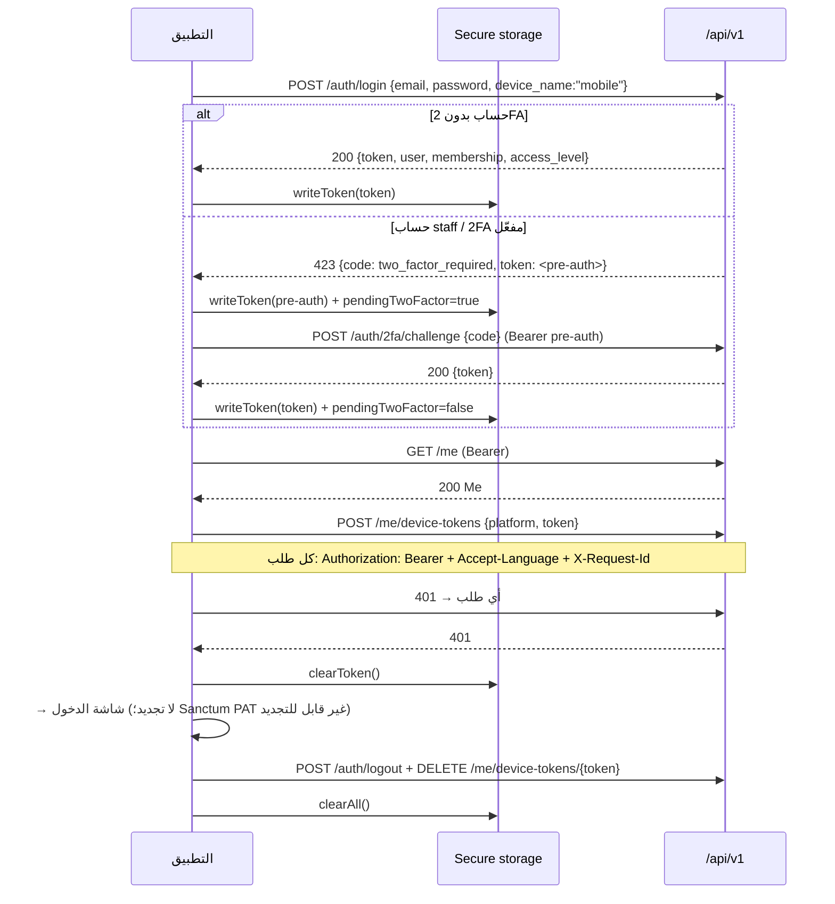
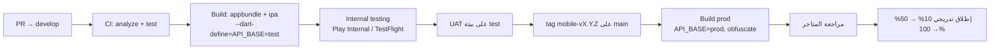

# تطبيق الجوال — التصميم والتكامل

> يكمّل [`mobile/README.md`](../mobile/README.md) (الإعداد والبناء) بالقرارات التصميمية والتشغيلية. المرحلة: هيكل جاهز في P1، تفعيل ونشر في P2 (SPEC §0، §12).

---

## 1. كيف صُمّم الـ API للجوال أولًا

| المبدأ | التطبيق في `/api/v1` | الأثر على التطبيق |
|---|---|---|
| **JSON فقط، لا HTML** | Laravel API-only، لا Blade؛ الأخطاء JSON موحّدة `{message, errors, code}` | لا تحليل HTML، معالجة أخطاء واحدة (`ApiException`) |
| **إصدار في المسار** | `/api/v1` ثابت؛ كسر التوافق = `/api/v2` بالتوازي 6 أشهر | تطبيق قديم على المتجر يستمر بالعمل |
| **مصادقة بالرمز** | Sanctum PAT مع `device_name`؛ نفس المسارات للويب (كوكي) والجوال (Bearer) | لا تدفق OAuth معقّد؛ رمز في Keychain/Keystore |
| **تسجيل أجهزة الدفع** | `POST /me/device-tokens {platform, token}` idempotent + `DELETE` عند الخروج | إشعارات موجّهة لكل جهاز |
| **موارد مُشكَّلة بالخادم** | `OpportunityCardResource` / `OpportunityDetailResource($accessLevel)` يُرجعان ما يحق للمستدعي فقط | التطبيق لا يحمل منطق حساسية؛ يعرض ما يصله |
| **تسميات مترجمة من الخادم** | `Accept-Language` يُترجم التصنيفات والرسائل | لا نسخ من التصنيفات في التطبيق |
| **ترقيم وتصفية موحّدة** | `page/per_page` + `filter[...]` + `sort` + `search` | تمرير لانهائي بسيط |
| **لوحات مجمّعة** | `/investor/dashboard` و`/entrepreneur/dashboard` تُرجع العدادات والقوائم في استدعاء واحد | شاشة واحدة = طلب واحد |
| **معرّفات غير قابلة للتعداد** | UUID v4 على الفرص والمستندات والمستخدمين | روابط عميقة آمنة |
| **`X-Request-Id`** | يُعاد في كل استجابة ويُسجَّل | تتبّع بلاغات المستخدمين |
| **أعلام الميزات من الخادم** | `GET /settings/public → features.*` | إخفاء شاشات (المدفوعات، الإنجليزية) دون إصدار جديد |

---

## 2. تدفق الرموز

قواعد:
- الرمز في `flutter_secure_storage` فقط (Keychain `first_unlock_this_device` / EncryptedSharedPreferences).
- لا تخزين للرمز في السجلات أو تقارير الأعطال (`Sentry beforeSend` يحذف `Authorization`).
- انتهاء الرمز بعد 90 يومًا من آخر استخدام (خادم)؛ التطبيق يتعامل مع 401 بإعادة الدخول.
- تغيير كلمة المرور من الويب يُبطل كل الرموز → التطبيق يعود للدخول تلقائيًا.

---

## 3. إشعارات الدفع

| البند | القرار |
|---|---|
| المزوّد | FCM لـ Android؛ APNs عبر FCM لـ iOS (مزوّد واحد في الخادم) |
| التجريد | `PushProvider` في التطبيق؛ `PushChannel` في Laravel (قناة إشعار إضافية بجانب database/mail/sms) |
| المحتوى | **عنوان + نص قصير + `route`** داخلي فقط. لا أسماء مستثمرين، لا مبالغ، لا محتوى مستندات (PRV-05) |
| أمثلة | «تحديث على فرصتك» → `/projects`؛ «ترشيح جديد» → `/dashboard`؛ «رد على طلب معلومات» → `/opportunities/<uuid>` |
| التفضيلات | نفس `notification_preferences` (الفئة × القناة)؛ قناة `push` تُضاف للتعداد في P2 |
| التسجيل | عند أول مصادقة وعند `onTokenRefresh`؛ `last_seen_at` يُحدَّث؛ الرموز غير المستخدمة 180 يومًا تُحذف |
| الخروج | `DELETE /me/device-tokens/{token}` قبل مسح التخزين |
| الأذونات | iOS: طلب الإذن بعد أول شاشة ذات قيمة (اللوحة) لا عند الإقلاع؛ Android 13+: `POST_NOTIFICATIONS` بنفس التوقيت |

---

## 4. قواعد العمل دون اتصال (Offline)

التطبيق **ليس offline-first**؛ البيانات حساسة وتتغير بالموافقات. القواعد:

| يُسمح | لا يُسمح |
|---|---|
| عرض آخر نسخة من اللوحة وقائمة الفرص (ذاكرة التطبيق أثناء الجلسة فقط) | تخزين تفاصيل الفرص أو المستندات على القرص |
| تخزين اللغة وتفضيلات العرض | تخزين الرمز خارج Secure storage |
| قائمة انتظار لإجراء واحد قصير (حفظ فرصة) تُعاد عند الاتصال | قائمة انتظار لإبداء اهتمام أو موافقة مالك (تتطلب حالة حديثة) |
| عرض رسالة «لا اتصال» مع إعادة المحاولة | أي تنزيل مستند أثناء انقطاع (الروابط موقّعة ومؤقتة) |

التنفيذ: `ApiException.isNetwork` → شاشة `ErrorState` بزر إعادة المحاولة؛ `SessionNotifier.restore()` يُبقي الرمز عند انقطاع الشبكة ولا يخرج المستخدم.

---

## 5. خط الإصدار

| البند | القرار |
|---|---|
| الإصدار | `pubspec.yaml: version: X.Y.Z+build`؛ build رقم تصاعدي من CI |
| التوقيع | Android: keystore في خزنة المجلس، `key.properties` خارج git؛ iOS: شهادة توزيع لحساب المجلس، `match` أو تحميل يدوي |
| التشويش | `--obfuscate --split-debug-info` للإنتاج؛ رموز التصحيح تُرفع إلى Sentry |
| الحد الأدنى للنظام | iOS 15+، Android 8.0 (API 26)+ |
| الإطلاق | تدريجي على Play؛ phased release على App Store |
| التوافق مع الـ API | `GET /version`؛ التطبيق يعرض «يلزم التحديث» إذا كان الحد الأدنى المدعوم (من `settings.public`) أعلى من إصداره |

---

## 6. متطلبات المتاجر

| المتطلب | App Store | Google Play | تنفيذنا |
|---|---|---|---|
| سياسة خصوصية عامة | إلزامي | إلزامي | `sciis.sa/privacy` (نفس `pages`) |
| إفصاح البيانات | App Privacy (nutrition labels) | Data safety form | الاسم، البريد، الجوال، معرّف الجهاز — للحساب والإشعارات؛ لا تتبّع إعلاني؛ لا بيع بيانات |
| حذف الحساب داخل التطبيق | إلزامي (5.1.1(v)) | إلزامي | شاشة الحساب → «طلب حذف حسابي» → `/me/data-requests {erase}` |
| تسجيل دخول بحسابات ثالثة | إن وُجد Google/Facebook يلزم Sign in with Apple | — | لا دخول اجتماعي في P1 → لا التزام |
| حساب مراجعة | إلزامي | موصى | مستثمر معتمد افتراضي + صاحب مشروع افتراضي على بيئة test |
| «الحد الأدنى من الوظائف» (4.2) | يرفض تطبيقات WebView | سياسة مشابهة | **تطبيق أصيل بالكامل، لا WebView** |
| التشفير (export compliance) | تصريح | — | `ITSAppUsesNonExemptEncryption=false` (TLS قياسي فقط) |
| الأذونات | تبرير كل إذن | — | إشعارات فقط في P1؛ لا كاميرا/موقع |
| لقطات وأوصاف | عربية + إنجليزية | عربية + إنجليزية | من بيئة test ببيانات «(افتراضي)» |
| الفئة | Business / Finance؟ | Business | **Business** (لتجنّب اشتراطات التطبيقات المالية؛ المنصة لا تتعامل بأموال صفقات) |

---

## 7. خصوصيات RTL والعربية

| الموضوع | القرار |
|---|---|
| الاتجاه | يتبع اللغة تلقائيًا عبر `MaterialApp.locale` + `GlobalWidgetsLocalizations`؛ لا `Directionality` يدوي إلا لحقول البريد/الهاتف/الرموز (`TextDirection.ltr`) |
| الخط | IBM Plex Sans Arabic (OFL) للعربية والإنجليزية والأرقام — تطابق الويب (SPEC §10) |
| الأرقام | أرقام غربية (0-9) في اللغتين لسلامة النسخ والأرقام المرجعية؛ فواصل الآلاف بـ `NumberFormat('en')` |
| التواريخ | `DateFormat.yMMMd('ar')` (هجري غير مطلوب في P1؛ يُضاف عبر `hijri` package عند الطلب) |
| الأيقونات الاتجاهية | `Icons.chevron_left` للأمام في RTL؛ أو `Directionality`-aware عبر `AlignmentDirectional`/`EdgeInsetsDirectional` (مستخدمة في الكود) |
| الحشو والمحاذاة | `EdgeInsetsDirectional` و`AlignmentDirectional` دائمًا؛ لا `left/right` |
| تكبير النص | محصور 0.9–1.3 لثبات التخطيط العربي (`MediaQuery.textScaler.clamp`) |
| النصوص | كلها في `app_ar.arb` (القالب) و`app_en.arb`؛ `gen-l10n` يُنتج `AppLocalizations`؛ لا نصوص ثابتة في الودجات |
| ألوان الحالات | من `OpportunityStatus.color` المطابقة لـ SPEC §10 — نفس الويب |
| إمكانية الوصول | تباين AA؛ `Semantics` على الأزرار الأيقونية (`tooltip`)؛ أحجام لمس ≥ 48dp |

