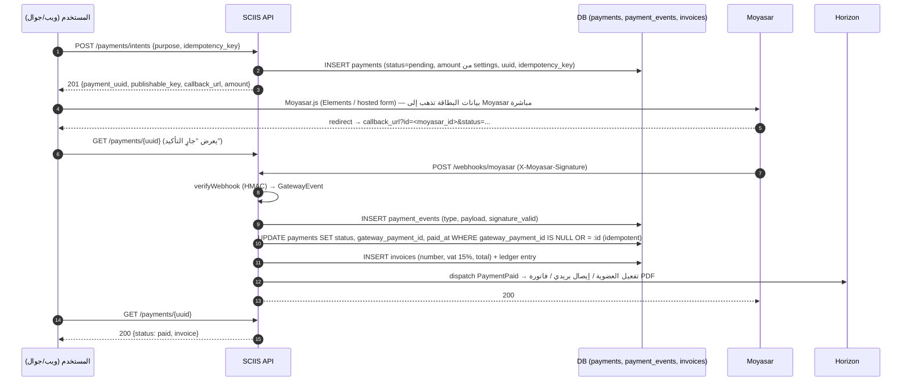

<div dir="rtl">

# المدفوعات — الحدود والتصميم

> المدفوعات **معطّلة في P1** (`FEATURE_PAYMENTS=false`، `membership.fee_sar=0` في مرحلة التأسيس) وتُشغَّل في P2. هذه الوثيقة تثبّت الحدود القانونية والتصميم حتى لا يتغير المخطط لاحقًا.

---

## 1. الحدود القانونية (غير قابلة للتفاوض)

| مسموح (الوثيقة §16.2) | ممنوع (الوثيقة §4.1، §16.1) |
|---|---|
| رسوم العضوية (`membership_fee`) | تحصيل أموال المستثمرين لصالح صفقات |
| رسوم خدمات مدفوعة (`service_fee`) — تقارير، استشارات | حفظ أموال كضمان (escrow) أو وسيط |
| رسوم تدريب (`training`) | إصدار أو ترويج أوراق مالية أو وحدات صناديق |
| رعاية (`sponsorship`) | أي نشاط يتطلب ترخيصًا من هيئة السوق المالية أو البنك المركزي |

الضمانات التقنية:
- `PaymentPurpose` تعداد مغلق بأربع قيم؛ لا حقل `opportunity_id` أو `interest_id` في `payments` **عمدًا**.
- `createIntent` يرفض أي غرض خارج التعداد (422) ويحدد المبلغ من `settings` لـ `membership_fee`.
- أي اتفاقية استثمار (AGR) تُوثَّق فقط؛ المنصة ليست طرفًا إلا إذا قرر المجلس (`council_is_party`) وبعد رأي قانوني، ولا تمرّ أموالها عبر المنصة.
- صفحة الشروط تنص على ذلك صراحة (بانتظار الاعتماد القانوني).

---

## 2. تجريد البوابة

```php
interface PaymentGateway
{
    /** يُنشئ نية دفع لدى البوابة ويعيد ما يحتاجه العميل لإكمال الدفع */
    public function createIntent(Payment $payment): GatewayIntent;   // {gateway_payment_id?, publishable_key, callback_url, form_type}

    /** يجلب الحالة الحالية من البوابة (للمطابقة) */
    public function fetch(string $gatewayPaymentId): GatewayPayment;

    /** استرداد كامل أو جزئي */
    public function refund(Payment $payment, ?int $amountHalalas = null, ?string $reason = null): GatewayRefund;

    /** يتحقق من توقيع الـ webhook ويعيد الحدث المطبَّع */
    public function verifyWebhook(Request $request): GatewayEvent;   // يرمي InvalidSignatureException
}
```

| المشغّل | الحالة | ملاحظات |
|---|---|---|
| `MoyasarGateway` | P2 | Mada، Visa/MC، Apple Pay، STC Pay |
| `FakeGateway` | اختبارات | يحاكي النجاح/الفشل/الاسترداد والتوقيع |
| `PayTabsGateway`, `HyperPayGateway`, `TapGateway` | محتمل | تبديل = مشغّل جديد + `config('payments.driver')` |

اختبار العقد (`GatewayContractTest`) يُشغَّل على كل مشغّل: إنشاء نية → محاكاة webhook صالح/مزوّر → استرداد.

---

## 3. تدفق Moyasar



تفاصيل:
- **لا تمر بيانات البطاقة عبر خوادمنا** (Moyasar Elements أو النموذج المستضاف) → نطاق PCI DSS = SAQ-A.
- `callback_url` للعرض فقط؛ **الحقيقة من الـ webhook** (أو من `fetch()` عند المطابقة)، لا من معاملات الـ redirect.
- `gateway_payload` يخزّن استجابة Moyasar كما هي (JSONB) باستثناء أي PAN (لا تُعاد أصلًا).

---

## 4. Idempotency

| الطبقة | الآلية |
|---|---|
| إنشاء النية | `idempotency_key` (UUID من العميل) فريد في `payments`؛ تكرار الطلب يعيد النية نفسها (200) |
| الـ webhook | فريد على `gateway_payment_id` + `payment_events(payment_id, type, gateway_event_id)` فريد؛ التكرار يُسجَّل كحدث مكرر ويُرجع 200 دون تغيير |
| انتقال الحالة | `PaymentStateMachine`: `pending → authorized|paid|failed|cancelled`, `paid → refunded`؛ أي انتقال آخر يُسجَّل تحذيرًا ويُتجاهل |
| الأثر الجانبي | `PaymentPaid` يُنفَّذ عبر listener idempotent (يتحقق من `memberships.paid_until` قبل التمديد) |

---

## 5. المطابقة (Reconciliation)

| التكرار | الإجراء |
|---|---|
| كل ساعة | `payments:reconcile-pending`: لكل `pending` أقدم من 30 دقيقة → `fetch()` من Moyasar وتحديث الحالة (يعالج فقدان webhook) |
| يومي 03:00 | `payments:reconcile-daily`: مقارنة كل مدفوعات الأمس (`paid`, `refunded`) مع قائمة Moyasar عبر API (`GET /v1/payments?created[gt]=`)؛ أي فرق → تذكرة في `/admin/dashboard` + بريد للمالية |
| شهري | تصدير `GET /admin/payments/export.xlsx` ومطابقته مع كشف التسوية البنكي (settlement) من Moyasar: المبلغ الإجمالي − رسوم البوابة = المحوَّل |

سجل الأستاذ الداخلي (`Ledger`): جدول `ledger_entries(payment_id, type debit|credit, account, amount, created_at)` إدخال فقط؛ يُغذّي التقارير ويُطابَق مع `payments`.

---

## 6. الاسترداد

| القاعدة | التنفيذ |
|---|---|
| من يسترد | `super_admin` فقط (`POST /admin/payments/{uuid}/refund`)؛ مُدقَّق |
| كامل/جزئي | `amount` اختياري؛ الجزئي مسموح مرة واحدة في P2 |
| الحالة | الطلب يضع `refund_requested_at`؛ الحالة النهائية `refunded` من الـ webhook (`refunded` event) |
| الفاتورة | إشعار دائن (credit note) برقم متسلسل مستقل، مرتبط بالفاتورة الأصلية |
| العضوية | استرداد رسم العضوية خلال 14 يومًا يُلغي التفعيل تلقائيًا؛ بعدها قرار إداري |
| Mada | الاسترداد لبطاقات مدى قد يستغرق حتى 10 أيام عمل — يُذكر في الرسالة |

---

## 7. الفاتورة الضريبية وجاهزية الفوترة الإلكترونية (ZATCA)

| البند | القرار |
|---|---|
| ضريبة القيمة المضافة | 15٪ على رسوم العضوية والخدمات والتدريب والرعاية (ما لم يقرر المستشار الضريبي إعفاءً) — `invoices.vat_rate` قابل للتعديل من الإعدادات |
| ترقيم الفواتير | متسلسل بلا فجوات `INV-YYYY-NNNNNN`؛ الإشعارات الدائنة `CN-YYYY-NNNNNN` |
| محتوى الفاتورة | اسم المجلس ورقمه الضريبي، اسم العميل ورقمه الضريبي إن وُجد (B2B)، الوصف، المبلغ قبل الضريبة، الضريبة، الإجمالي، التاريخ، رمز QR |
| **المرحلة الأولى (الإصدار)** | فاتورة PDF/A-3 تتضمن XML مضمّنًا ورمز QR بصيغة TLV (Base64) وفق مواصفة ZATCA — تُولَّد بمكتبة PHP (مثل `salla/zatca`) |
| **المرحلة الثانية (الربط)** | عند بلوغ المجلس موجة الربط: تكامل مع منصة فاتورة (CSID، توقيع XML، إرسال للتصديق/الإبلاغ). مُجرَّد خلف `InvoiceSubmitter` interface؛ لا يُنفَّذ قبل تحديد الموجة |
| الحفظ | الفواتير وXML لمدة 10 سنوات في الحاوية (`documents.kind=agreement`? لا — `kind=invoice` يُضاف للتعداد في P2) |
| الاعتماد | **يتطلب مراجعة المستشار الضريبي/القانوني** للمجلس قبل أول فاتورة — خاصة الوضع الضريبي لرسوم العضوية في كيان غير ربحي |

---

## 8. ملاحظات Apple Pay و Mada

| | ملاحظة |
|---|---|
| **Mada** | إلزامية فعليًا في السوق السعودي؛ Moyasar تدعمها عبر نفس التكامل؛ لا يُسمح بتقسيط Mada ولا بالـ recurring دون موافقة؛ الاسترداد أبطأ |
| **Apple Pay (ويب)** | يتطلب التحقق من النطاق `sciis.sa` لدى Apple عبر Moyasar (ملف `.well-known/apple-developer-merchantid-domain-association`) — يُخدَم من Nuxt |
| **Apple Pay (تطبيق iOS)** | Merchant ID في حساب Apple Developer للمجلس + Capability؛ الزر عبر Moyasar SDK أو `pay` package؛ **التطبيق لا يبيع محتوى رقميًا داخل التطبيق** (العضوية خدمة واقعية) → لا يخضع لـ In-App Purchase وفق 3.1.3(e)؛ يُوثَّق في ملاحظات المراجعة |
| **STC Pay** | عبر Moyasar؛ تدفق redirect |
| **Google Pay** | غير مدعوم من Moyasar حاليًا؛ تُستخدم البطاقات |

---

## 9. بطاقات الاختبار (بيئة Moyasar التجريبية)

| البطاقة | الرقم | النتيجة |
|---|---|---|
| Visa نجاح | `4111 1111 1111 1111` | `paid` |
| Mastercard نجاح | `5105 1051 0510 5100` | `paid` |
| Mada نجاح | `4464 0400 0000 0007` | `paid` (3DS) |
| Visa رفض | `4000 0000 0000 0002` | `failed` — `DECLINED` |
| رصيد غير كافٍ | `4000 0000 0000 9995` | `failed` — `INSUFFICIENT_FUNDS` |

تاريخ انتهاء مستقبلي، CVC أي 3 أرقام، كلمة مرور 3DS التجريبية حسب وثائق Moyasar. **تُراجَع الأرقام من وثائق Moyasar وقت التنفيذ** إذ قد تتغير.

في الاختبارات الآلية يُستخدم `FakeGateway` لا بيئة Moyasar.

---

## 10. علم الميزة والتشغيل

| الطبقة | التحكم |
|---|---|
| البيئة | `FEATURE_PAYMENTS=false` يحجب تسجيل مسارات `/payments/*` و`/admin/payments*` كليًا (404) |
| الإعدادات | `features.payments` في `settings` (يتبع البيئة عند الإقلاع؛ قابل للتعطيل الطارئ من `/admin/settings` دون نشر) |
| الواجهات | `GET /settings/public → features.payments` يُخفي شاشات الدفع في الويب والجوال |
| الرسوم | `membership.fee_sar=0` → زر «ادفع» لا يظهر حتى لو الميزة مفعّلة |
| التشغيل في P2 | 1) رأي قانوني/ضريبي؛ 2) عقد Moyasar وحساب إنتاجي؛ 3) تفعيل على test ببطاقات تجريبية؛ 4) اختبار اختراق للمسار؛ 5) تفعيل الإنتاج بـ `FEATURE_PAYMENTS=true` + ضبط الرسوم |

</div>
